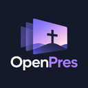
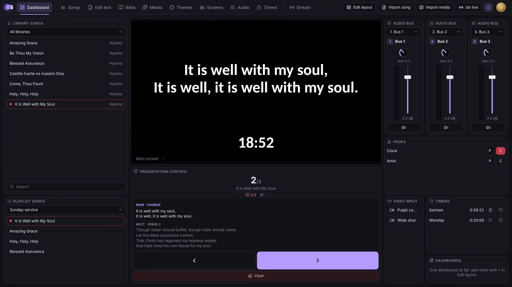
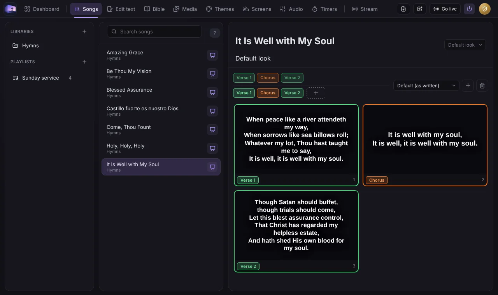
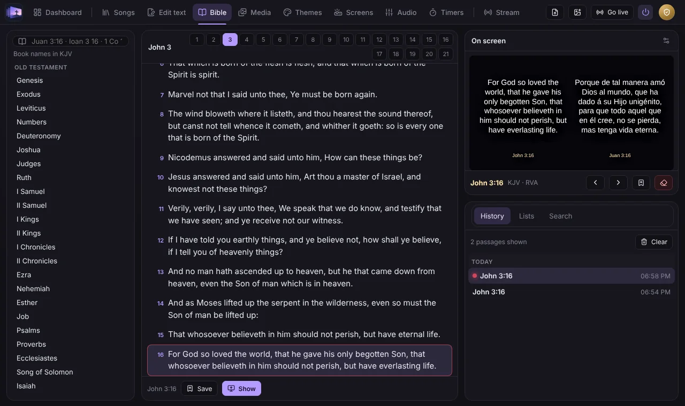
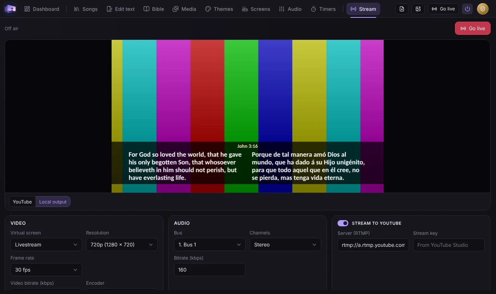
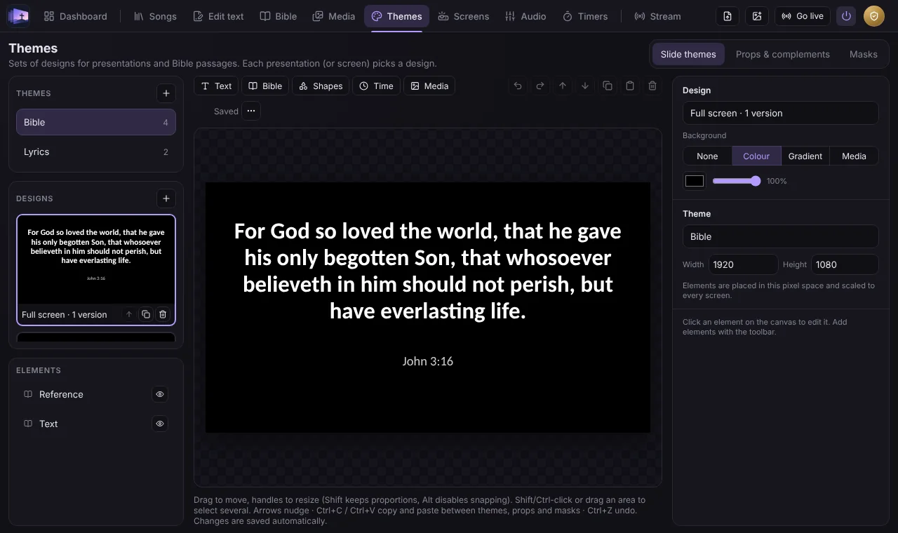

<p align="center">
  
</p>

<h1 align="center">OpenPres</h1>

<p align="center">
  Lyrics, Bible, media and the livestream for Sunday services and events, from one place.<br>
  <a href="https://nathandsanta.github.io/OpenPres/">Website</a> ·
  <a href="https://github.com/NathanDSanta/OpenPres/releases/latest">Download</a> ·
  <a href="docs/">Documentation</a>
</p>



OpenPres is presentation software for churches and events. It runs on the computer connected
to the screens, and everyone else manages it from their own computer or tablet: the person on
lyrics, the one on the stream, the one on sound. Each sees what their job needs. Everything
runs on your own network: no account and no subscription.

It runs on Windows, macOS and Linux.

## What it does

- **Songs.** Each song is split into verses, choruses and bridges, coloured by part. Put them
  in any order for this Sunday, keep several arrangements, and build the service's playlist.
  Import songs from text, or from other programs with import templates. You can edit the
  words while presenting: what's live stays until you move on.
- **The Bible.** Type a reference ("John 3:16", "Juan 3:16") or browse book and chapter. Show
  one version, or two side by side. The King James Version (1769), the Reina-Valera Antigua
  (1909) and the Cornilescu Bible (1924) come with it, and you can import others. Keep a
  history and lists of the passages for the sermon.
- **Livestream.** Stream to YouTube or record. The stream has its own screen, so it can show
  a camera with the lyrics as a lower third while the room sees them full screen. Cameras and
  capture cards are video inputs.
- **Screens.** The main screen, the livestream and the stage display are virtual screens, each
  with its own designs and layers (lyrics, Bible, media, cameras, announcements, props). Drag a
  virtual screen onto a monitor or projector to show it there. Screen presets switch a
  screen's layers in one click, and clear groups take several layers off at once.
- **Themes.** Place text, shapes, the clock and media where you want them, with their fonts,
  colours and backgrounds. New installs start with ready-made designs.
- **Media, audio and timers.** Images, videos and audio with playlists; mixer buses with gain,
  faders and meters (the stream takes the bus you choose); countdowns and timers to the start
  or end of the service.
- **Stream Deck.** A plugin for Elgato's Stream Deck app and [OpenDeck](https://github.com/nekename/OpenDeck):
  slides, Bible passages, props, cameras, media, timers and the stream on buttons. It's on
  its own branch: see [its README](https://github.com/NathanDSanta/OpenPres/tree/streamdeck/develop#readme).
  Each release has it ready to install.
- **Automatic updates.** Installed copies update from this repository's releases, by
  themselves when nothing is live if the admin turns that on. See [docs/UPDATES.md](docs/UPDATES.md).

<table>
  <tr>
    <td width="50%"></td>
    <td width="50%"></td>
  </tr>
  <tr>
    <td></td>
    <td></td>
  </tr>
</table>

<sub>The screenshots come from a simulated session: public-domain hymns and Bibles, and test
pictures in place of real cameras.</sub>

## How it works

OpenPres is one program with two roles:

- **The server** runs on the computer connected to the screens. It runs in the background
  (a tray icon, no main window), starts with the computer, and does everything: the screens,
  the stream, the songs and media.
- **The manager** is what everyone opens. It finds servers on the network by itself, or takes
  an address, and opens the chosen server's interface. A tablet can open the server's address
  in its browser instead.

The first time OpenPres opens, it asks whether this computer is the server. The server list
changes that later ("Use it as a server" / "Stop using it as a server"). On Windows the
installer can ask instead ([docs/WINDOWS-INSTALLER.md](docs/WINDOWS-INSTALLER.md)).

Each person chooses a **mode**: Livestream, Stage, Jack of all trades or Admin. Each mode has
its own dashboards, made of widgets you arrange yourself. The general settings stay with the
Admin.

## Download

The [latest release](https://github.com/NathanDSanta/OpenPres/releases/latest) has a file for
each computer, named `OpenPres-<version>-<system>-<processor>`:

| Computer | File |
|---|---|
| Windows 10/11 | `…-Windows-x64-Setup.exe` (installer) or `…-Windows-x64.msi` (for IT deployment) |
| Windows on ARM | `…-Windows-ARM64-Setup.exe` or `…-Windows-ARM64.msi` |
| Mac with Apple Silicon (M1 and newer) | `…-macOS-Apple-Silicon.dmg` |
| Mac with an Intel processor | `…-macOS-Intel.dmg` |
| Linux, 64-bit PC | `…-Linux-x64.AppImage` (any distribution), `.deb` (Debian, Ubuntu, Mint) or `.rpm` (Fedora, openSUSE) |
| Linux on ARM (e.g. Raspberry Pi 5) | `…-Linux-ARM64.AppImage`, `.deb` or `.rpm` |
| Stream Deck / OpenDeck | `…-StreamDeck-Plugin.streamDeckPlugin` |

Every release also has `SHA256SUMS.txt` with the checksum of each file.

The installers aren't code-signed yet:

- **Windows** may show a SmartScreen warning: **More info → Run anyway**.
- **macOS** won't open the app the first time. Control-click it in Applications and choose
  **Open**. If macOS says the app is damaged, run
  `xattr -dr com.apple.quarantine /Applications/OpenPres.app` in Terminal.

## Documentation

| Document | What it covers |
|---|---|
| [docs/GLOSSARY.md](docs/GLOSSARY.md) | The words OpenPres uses: one for each thing |
| [docs/FILES.md](docs/FILES.md) | Where OpenPres keeps its settings, data and log files |
| [docs/UPDATES.md](docs/UPDATES.md) | How the manager and the server update, and automatic updates |
| [docs/WINDOWS-INSTALLER.md](docs/WINDOWS-INSTALLER.md) | The Windows installer's server page and the tray icon |
| [The Stream Deck plugin's README](https://github.com/NathanDSanta/OpenPres/tree/streamdeck/develop#readme) | The plugin's keys and settings (on the `streamdeck/develop` branch) |
| [docs/RELEASING.md](docs/RELEASING.md) | Branches, versions, and how releases are made |
| [docs/TELEGRAM.md](docs/TELEGRAM.md) | Merging pull requests from Telegram |

## Building from source

You need [Node.js](https://nodejs.org) (LTS), [Rust](https://rustup.rs) (stable) and
[Tauri's prerequisites](https://v2.tauri.app/start/prerequisites/) for your system. On
Debian or Ubuntu:

```sh
sudo apt-get install libwebkit2gtk-4.1-dev build-essential curl wget file libssl-dev \
  libgtk-3-dev libayatana-appindicator3-dev librsvg2-dev pkg-config libudev-dev \
  libasound2-dev gstreamer1.0-plugins-base gstreamer1.0-plugins-good \
  gstreamer1.0-plugins-bad gstreamer1.0-libav gstreamer1.0-gl
```

Then:

```sh
npm ci
npm run tauri dev      # opens the manager; choose "This computer is the server" to run one
npm run tauri build    # installers for this computer, in tauri/target/release/bundle/
```

Both download a static ffmpeg into `tauri/binaries/` first (`npm run ffmpeg`), which ships
next to the app.

The checks that run on every pull request:

```sh
npm run build                              # type-check and build the interface
node --test scripts/release/lib.test.mjs   # release scripts
(cd tauri && cargo test --lib)             # server and API
```

The Stream Deck plugin (`streamdeck/develop`) and the Android app (`android/develop`) are
on their own branches, each with its own checks.

### Where things are

| Folder | What's in it |
|---|---|
| `src/` | The interface (React and TypeScript): dashboards, widgets, editors, the server list |
| `tauri/` | The server and the manager (Rust, Tauri 2): the API, screens, stream, audio, devices, updates |
| `scripts/release/` | Versioning, release notes, file names and the update manifest |
| `docs/` | Documentation |

## Contributing

`develop` is the default branch. Changes go in through pull requests into `develop`, with a
[Conventional Commit](https://www.conventionalcommits.org) title (`feat: …`, `fix: …`,
`docs: …`); the title decides the next version. Releases are made from `main` by themselves
once enough has changed. See [docs/RELEASING.md](docs/RELEASING.md).

Bugs and ideas: [open an issue](https://github.com/NathanDSanta/OpenPres/issues).
